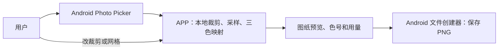
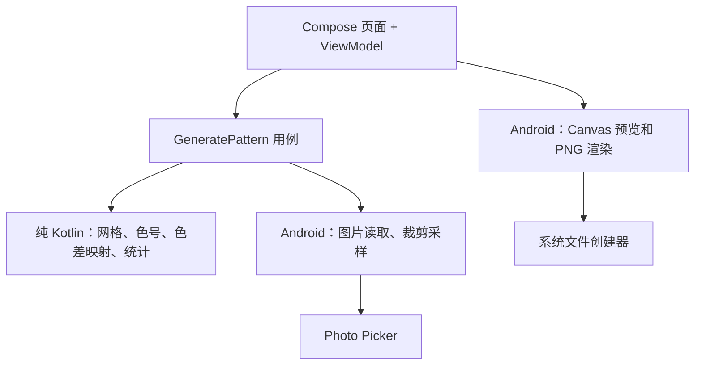

# 图片转拼豆图纸 APP 架构（历史三色版）

> 状态：历史版本 · 2026-09-26
> 平台：Android 原生（Kotlin + Jetpack Compose）
> 用户已取消三色限制。当前以 [当前架构与色卡依据](../mcp-current-architecture-v071.md) 为准；本文保留用于追溯，H2/E16/H7、ByteArray 和固定三项图例等限制不再适用。

## 1. 目标与边界

用户选择一张图片，调整裁剪和网格尺寸，得到**只含 MARD H2、E16、H7** 的拼豆图纸，在屏幕预览每格色号与用量，并保存一张可打印或分享的 PNG 图纸。整个过程在设备本地完成。

**项目范围仅为 Android APP。**当前项目不设计、制作或控制实体拼豆板、灯板及其固件；也不规划 APP 与硬件的通信功能。这里的“图纸”只指由图片生成、可在 APP 中查看和导出的拼豆格子图。

**最低支持系统：Android 12（API 31），工程设置 `minSdk = 31`。**这表示 Android 12 及以上系统可以安装。`compileSdk` 和 `targetSdk` 是独立设置，不改变最低安装版本；首版按创建工程时的稳定 SDK 版本确定它们，不以当前已安装的 Android 17 Preview 作为发布基线。

首版范围：图片选择、方向修正、裁剪与缩放、网格尺寸调整、三色量化、预览、三色颗数统计、PNG 导出。首版不做账号、网络同步、其他色号、多色库切换、手动逐格编辑、工程列表或 PDF/CSV。H2 与 E16 很接近，彩色照片转换后会显著丢失色彩和层次；结果预览及格内**色号**是制作依据，原图缩略图只供对照。

复用旧方案中仍适用的约束：Android 原生、Compose、离线处理、Photo Picker 最小权限、按网格比例裁剪、后台解码与计算、单个 Canvas 绘制网格，以及大图缩采样。旧方案的硬件与灯板协议、联网、任意 K 色优化、工程保存及复杂编辑功能全部失效。

## 2. 首批色号与色值依据

| 色号 | 常见称呼 | 首版屏显参考 HEX | 用途与注意 |
|---|---|---|---|
| H2 | 白色 | `#FBFBFB` | 亮部与默认透明背景 |
| E16 | 浅肤色、偏白肤色 | `#FBF4EC` | 暖色亮部，与 H2 屏显区别很小 |
| H7 | 黑色 | `#010101` | 暗部 |

这组 HEX 来自[豆豆工坊 Mard 色卡 v1](https://www.doudougongfang.com/kb/beads/mard-palette)，是**第三方屏显参考值**，不代表 MARD 官方实物测量值。MARD 色卡页面列出色号，但[不提供 HEX](https://mardbeads.com/mard-beads-color-chart)；[PixelBeads 的色号指南](https://www.pixelbeads.io/zh-cn/blog/mard-color-codes-guide)也提醒以购买店家的现行色号表为准。不同非官方色卡有色值差异，因此色值与来源必须一起记录为固定版本，例如 `mard-3-doudougongfang-v1`。未来取得同批次实体豆的受控拍摄或测色数据时，发布**新版本**并用固定测试图比较映射结果；不得静默覆盖旧版本或宣称当前 HEX 精确等于实物。

## 3. 用户流程与系统边界



1. 选择图片；APP 读取尺寸和方向，显示裁剪预览。
2. 选择列数与行数，裁剪框锁定同一宽高比；默认可用 29×29，首版允许 8～128 行/列且总格数不超过 16,384。
3. 用户平移、缩放图片后点击生成；调整裁剪或网格时重新生成。
4. 查看结果网格、H2/E16/H7 图例和各自颗数，可放大查看格内色号。
5. 保存 PNG。导出内容是当前已确认的颜色矩阵、网格线、尺寸、色号图例与颗数；导出时不重新运行颜色算法。

网格行列是用户输入，不按某种实体拼豆板规格预设。导出 PNG 的图例必须同时包含文字色号和数量，避免 H2/E16 在屏幕或打印中难以分辨。

## 4. 最小架构

采用**单个 `:app` Gradle 模块、按职责分包**。产品只有一个转换流程；多模块、仓储抽象、依赖注入框架和数据库目前没有收益。创建工程前包名待定，不从旧文档复制示例包名作为发布包名。



目录在实现相应功能时逐步创建：

```text
android-app/app/src/main/java/<package>/
├─ MainActivity.kt
├─ pattern/          # Palette、Pattern、颜色转换、三色匹配、统计；纯 Kotlin
├─ image/            # URI 解码、EXIF 方向、裁剪与区域采样；Android
├─ feature/convert/  # 页面、ViewModel、生成流程状态
└─ export/           # 共用图纸绘制逻辑、PNG 输出
```

`pattern` 不引用 `android.*` 或 Compose。ViewModel 持有一次生成的结果及参数；文件选择和导出由 Activity Result API 处理。转换和导出在后台执行，可取消；同一时间只运行一个生成任务。首版结果只保存在当前会话，重启后需要重新选图。

## 5. 数据契约

```kotlin
data class BeadColor(val code: String, val displayRgb: Int)
data class PaletteRevision(val id: String, val colors: List<BeadColor>)
data class GridSize(val columns: Int, val rows: Int)
data class CropSpec(val centerX: Float, val centerY: Float, val scale: Float)
data class Pattern(
    val grid: GridSize,
    val paletteRevision: String,
    val cells: ByteArray // 行优先；0=H2、1=E16、2=H7
)
```

`Pattern` 的约束：`cells.size == rows * columns`，每个值只能是 0、1、2，行列数及格数在上述上限内。色号顺序由版本化常量固定，不能依赖普通 `Map` 的遍历顺序。各色用量由 `cells` 计算，三项相加必须等于格数。`CropSpec` 坐标相对修正方向后的图片归一化，裁剪框始终与网格同比例。生成结果创建时复制 `ByteArray`，之后只读；PNG 使用该结果的快照，预览和导出共用同一颜色矩阵。

## 6. 图像处理与三色映射

```text
URI → 读尺寸/方向 → 按目标尺寸缩采样解码 → 转 sRGB
    → 修正 EXIF 方向 → 透明像素合成 H2 参考白底
    → 按网格比例裁剪 → 每格区域采样 → Lab(D65)
    → 与三色计算 ΔE00 → 选择最近色号 → Pattern
```

- 大图先读取元信息并确定裁剪区域，再对该区域缩采样解码到覆盖目标网格及预览所需的工作尺寸；首版工作位图最长边上限 2048 像素，不完整解码 6000×4000 原图。区域采样在解码后的图上完成，不拉伸原图。
- 每格按对应图像区域取平均。先对 sRGB 通道做线性化，再在线性光空间按 alpha 与 H2 参考白底合成并做面积平均；不能只读取格子中心点。完全透明区因此得到 H2；首版不提供第四种“空格”或可选背景色。
- 将采样色转为 CIE Lab（D65），与三个参考色的 Lab 计算 CIEDE2000（ΔE00）；最小距离对应色号。完全相等时按 H2、E16、H7 固定顺序选择，以保证重复生成一致。首版不抖动，也不做任意 K 色优化，因为候选集始终只有三色。
- 基于参考 HEX 的最近色匹配仅是屏显近似。E16 与 H2 非常接近，浅肤色是否被选中会受输入亮度、白平衡和色卡版本影响；不设置无依据的“保证使用 E16”规则。用户用结果预览检查，并可改变裁剪或网格再生成。

## 7. 预览、导出与失败处理

预览用一个 Compose Canvas 批量绘制所有格子、网格线和缩放/平移后的视口。格子足够大时显示色号；缩小时只显示色块，图例始终显示 H2、E16、H7 的色号与数量。H2/E16 色块加边框，并使用可读文字区分。PNG 渲染从同一 `Pattern` 绘制完整网格与图例，设置导出像素上限，超过上限时提示用户降低导出比例，避免一次分配过大位图。首版可固定每格 24 像素，并限制总像素约 25 MP；实际阈值在真机测量后确定。

Photo Picker 取消不改变当前结果。图片不可读取或格式不支持时提示重选；尺寸异常时提示选择较小图片；内存不足时释放工作位图并提示降低网格或换图。生成任务取消后不发布半成品矩阵。文件创建器取消不报错；PNG 写入失败提示重试，不把失败结果标记为已保存。图片 URI 和像素内容不上传、不写入日志。选择图片用 Photo Picker，保存用 Storage Access Framework，不申请整个相册或传统存储权限。

性能目标是 29×29 在普通中端真机上生成时界面可操作，64×64 可在数秒内完成，128×128 可显示进度并取消；这些是验收预算，需真机测量，不能当作已实现性能。后台解码使用 IO 线程，采样和色差计算使用计算线程；Compose 重组中不执行颜色算法。

## 8. 架构决策与权衡

### ADR-001：单模块包级边界

**状态：提议中。背景：**单人或小团队实现一个离线转换流程。**决定：**使用一个 `:app` 模块，纯 Kotlin `pattern` 与 Android 适配代码分包。**备选：**从开始拆多个 Gradle 模块，可以强制编译依赖，但增加构建配置与维护成本。**影响：**开发和调试简单；包边界靠代码审查与测试维护。出现跨平台复用或多人长期并行开发需求时，再提取纯 Kotlin 模块。

### ADR-002：固定三色、版本化参考色值

**状态：提议中。背景：**用户首批仅有 H2/E16/H7，且没有可核实的统一官方 HEX。**决定：**硬编码带来源和版本的三色候选集，ΔE00 就近映射。**备选：**支持导入任意色卡或从网络更新色库，可减少未来改动，但现在会增加界面、校验与版本兼容复杂度。**影响：**输出稳定、容易测试；色彩表达能力有限，实物与屏显可能不同。实体校色后以新版本替换参考数据，并用基准图片回归验证。

### ADR-003：会话结果与 PNG

**状态：提议中。背景：**当前任务只要求图片变图纸。**决定：**首版只保留会话内结果，导出带色号和用量的 PNG。**备选：**保存可编辑工程并导出 PDF/CSV，可恢复和二次加工，但引入文件格式、迁移与多种渲染路径。**影响：**首版交付快；退出后不能继续调整旧图。用户确有保存/复编需求时，再依据 `Pattern` 增加项目文件。

## 9. 实施顺序与可检验验收

1. 建空 Compose 工程、三色常量与纯 Kotlin `Pattern`、Lab/ΔE00；用公开 CIEDE2000 测试对验证色差实现，并断言候选集**恰好**是 H2/E16/H7。
2. 接入 Photo Picker、EXIF、缩采样、裁剪和区域采样；用已知 2×2 色块、带透明区与旋转信息的图片核验方向、背景和格子结果。
3. 完成生成状态和 Canvas 预览；调整裁剪/网格后重新生成。确认所有格子只取三色、同参数重复生成一致、颗数总和等于行数乘列数，放大后能读到 H2/E16/H7 色号。
4. 实现 PNG 导出；用导出图与当前 `Pattern` 对照，验证网格、色号、三色数量一致，文件可由系统图库/文件应用打开。
5. 在 Android 12（API 31，最低支持版本）及当前稳定 Android 版本上验证 29×29、64×64、128×128 和 6000×4000 输入：无主线程长时间卡顿、无崩溃、128×128 可取消；记录耗时和峰值内存后再调整预算。

完成标准：用户从本地图片到可打开的 PNG 图纸无需联网；图纸只含三个指定色号，格子与用量正确，预览和导出一致；没有灯板、ESP32、网络或多色库入口。
