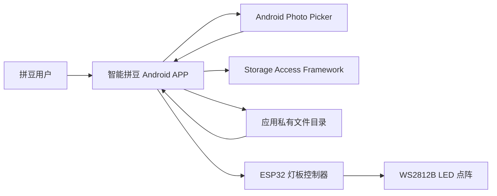
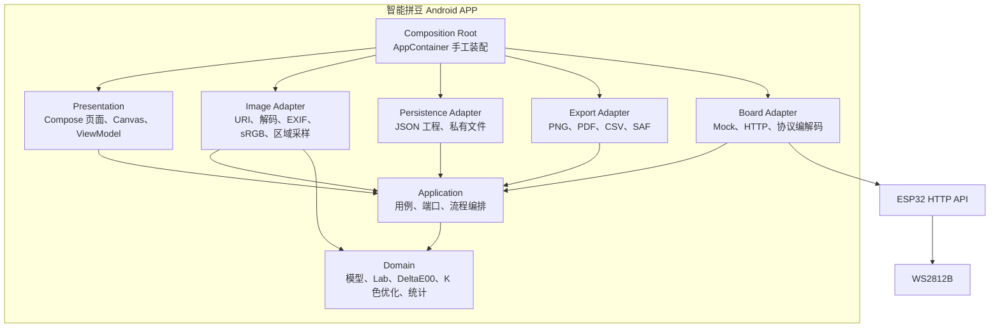

# 智能拼豆 APP 架构设计

> **已弃用（2026-09-26）**：本方案包含灯板通信等已取消的功能。当前开发以[图片转拼豆图纸 APP 架构](图片转拼豆图纸APP架构.md)为准。

> 状态：已弃用  
> 日期：2026-09-02  
> 项目：`D:\Codex\WorkSpace\智能拼豆`  
> 平台：Android  
> 技术栈：Kotlin + Jetpack Compose  
> 架构审查：`agency/engineering-software-architect`

相关文档：

- [智能拼豆 APP 开发准备与实施方案](智能拼豆APP开发准备与实施方案.md)

## 1. 架构结论

第一版采用：

> Kotlin + Jetpack Compose + 单向数据流 + 轻量分层模块化单体 + 手工依赖装配

工程暂时只使用一个 `app` Gradle 模块，通过 Kotlin 包划分领域、用例、适配器和界面层。

核心依赖方向：

```text
Compose UI
    ↓
Application 用例
    ↓
Domain 领域核心

Android、文件、网络适配器
    ↑ 实现 Application 定义的端口
```

第一阶段形成完整离线闭环：

```text
图片导入
→ 按网格比例裁剪
→ 区域采样
→ Lab/CIEDE2000 匹配
→ 最多 K 色
→ Canvas 编辑
→ 统计
→ JSON 保存
→ PNG/PDF/CSV 导出
```

第二阶段复用同一图纸模型：

```text
PatternProject
→ PatternSnapshot
→ LedFrame
→ MockBoardTransport
→ HttpBoardTransport
→ ESP32
→ WS2812B
```

## 2. 已知约束

- 只开发 Android 原生版本。
- Kotlin + Jetpack Compose 已确定。
- 第一版离线优先，不上传用户图片。
- 最低版本建议 API 26。
- 项目尚未创建，适合先建立轻量且清晰的边界。
- 图片可能达到 6000×4000 或更大。
- 网格建议支持 8×8 到 128×128。
- 自动生成颜色必须来自指定拼豆颜色库。
- 不能使用 RGB 欧氏距离作为最终匹配方法。
- 自动生成结果不得超过用户指定的 K 种颜色。
- 没有实体灯板时，图纸模块必须能独立开发和测试。
- ESP32 第一版真实通信使用 Wi-Fi + HTTP。
- 当前是单人或小团队的早期产品，不引入企业级架构复杂度。

## 3. 质量属性

### 3.1 正确性

- sRGB → XYZ → Lab 使用 D65 白点。
- CIEDE2000 标准测试数据在规定误差内通过。
- `cells.size == rows × columns`。
- 每个格子的颜色编号必须存在于当前色库版本。
- 所有颜色统计之和必须等于格子总数。
- 自动生成后使用颜色数不超过 K。
- 相同图片、裁剪参数、色库版本和算法参数产生相同结果。
- 保存后重新读取，颜色矩阵和参数完全一致。

### 3.2 响应速度

- 图片解码、采样、Lab 转换和 K 色优化不得在主线程执行。
- 普通中端真机上，29×29 颜色计算预算为 500 毫秒以内。
- 64×64 颜色计算预算为 2 秒以内。
- 128×128 可以更久，但必须显示进度并允许取消。
- Canvas 平移和缩放应保持流畅。
- 不为每个格子创建独立 Composable。

以上数字是性能预算，必须通过真机测量确认，不能提前声称已经达到。

### 3.3 内存

- 同时只保留一张算法工作位图和一张低分辨率预览图。
- 算法工作图最长边建议限制在约 2048 像素。
- 位图、距离矩阵和临时数组的峰值目标控制在约 64 MiB 内。
- 内部颜色和距离数据优先使用 `IntArray`、`FloatArray` 等连续结构。
- 导出大图时限制尺寸或分块绘制。

### 3.4 可靠性

- 工程保存采用临时文件写入成功后再替换正式文件。
- 原图需要长期编辑时复制到应用私有目录。
- 导出失败不能破坏已保存工程。
- 灯板通信失败不能影响本地图纸。
- HTTP 帧发送按单通道串行执行，避免旧帧晚到后覆盖新帧。

### 3.5 可维护性

- 领域算法不依赖 Android。
- 外部能力通过少量明确端口接入。
- 重要技术决策保留 ADR。
- 第一版不创建没有实际替换需求的接口和工厂。
- 功能变更应尽量局限在一到两个包内。

### 3.6 隐私与权限

- 图片默认只在设备本地处理。
- 不记录图片内容、完整 URI 或本地文件路径。
- Photo Picker 导入图片，不申请整个相册权限。
- Storage Access Framework 导出，不申请传统存储权限。
- 第一阶段不声明蓝牙、位置或局域网运行时权限。

## 4. 架构方案权衡

### 4.1 方案 A：单 `app` 模块，包级分层

结构：

```text
app
├─ domain
├─ application
├─ adapter
└─ presentation
```

优点：

- 初始构建和配置简单。
- 适合尚未创建工程的早期产品。
- 调试、运行和重构速度快。
- 不需要维护多个 Gradle 模块配置。
- 包边界清晰时，领域算法仍然可以独立测试。

代价：

- Gradle 不能强制全部包依赖规则。
- 项目扩大后，开发者可能绕过边界直接调用实现类。
- 无法按功能单独编译。

### 4.2 方案 B：从第一天拆分多个 Gradle 模块

可能结构：

```text
:app
:core:domain
:core:image
:core:storage
:feature:editor
:feature:export
:feature:board
```

优点：

- 编译层面可以强制依赖方向。
- 模块可以独立测试和复用。
- 多人长期并行开发时边界更清楚。

代价：

- 当前规模不足以抵消 Gradle 配置成本。
- Android 资源、Compose、序列化和测试配置会分散到多个模块。
- 需求仍在变化，模块边界可能反复调整。
- 增加新人理解和故障排查难度。

### 4.3 推荐决定

选择方案 A。

出现以下任一真实信号后，再提取 `:core:pattern` 或其他模块：

- 领域算法需要被桌面端、服务端或其他 APP 复用。
- 开发团队扩大，需要多人长期并行修改。
- 单模块构建时间出现明显问题。
- 包边界频繁被绕过，并形成循环依赖。
- 灯板协议需要作为独立 SDK 维护。

## 5. 系统上下文图



职责：

- Photo Picker 只授予图片读取能力。
- APP 负责所有图像处理、图纸编辑、统计和文件生成。
- 应用私有目录负责保存可恢复工程。
- Storage Access Framework 负责用户选定位置的导出文件。
- ESP32 接收规范化 LED 帧，并处理真实灯珠布线。

## 6. 容器与组件图



`Application` 定义外部端口，适配器实现端口。`AppContainer` 是唯一允许同时知道端口和具体实现类的地方。

## 7. 业务边界

### 7.1 图纸创作

核心业务：

- 网格生成。
- 色彩转换和匹配。
- K 色约束。
- 手动改色。
- 撤销和重做。
- 颜色统计。

这是系统的核心领域。

### 7.2 色库

负责：

- 拼豆颜色编号和名称。
- RGB、Lab 数据。
- 色库版本。
- 可用和停用颜色。
- 色库校验。

### 7.3 工程文件

负责：

- 保存和恢复图纸工程。
- JSON 版本迁移。
- 原图副本管理。
- 工程列表。

### 7.4 导出

负责把一致图纸快照转换为：

- PNG。
- PDF。
- UTF-8 CSV。

导出不得重新运行颜色算法。

### 7.5 灯板交付

负责：

- 将颜色编号矩阵映射为规范化 RGB 帧。
- 模拟发送。
- HTTP 发送。
- 协议版本和设备能力检查。

灯板模块不得读取 Android `Bitmap`，也不得直接操作图纸编辑状态。

## 8. 包结构

包名前缀在创建工程时正式确定，以下暂用 `com.smartbead.app`：

```text
com.smartbead.app/
├─ SmartBeadApplication.kt
├─ MainActivity.kt
├─ AppContainer.kt
│
├─ domain/
│  ├─ model/
│  │  ├─ LabColor.kt
│  │  ├─ BeadColor.kt
│  │  ├─ Palette.kt
│  │  ├─ GridSize.kt
│  │  ├─ CropSpec.kt
│  │  ├─ PatternProject.kt
│  │  ├─ PatternSnapshot.kt
│  │  └─ ColorCount.kt
│  ├─ color/
│  │  ├─ ColorConverter.kt
│  │  ├─ DeltaE2000.kt
│  │  ├─ GridColorMatcher.kt
│  │  └─ PaletteReducer.kt
│  ├─ editing/
│  │  ├─ PatternEditor.kt
│  │  ├─ CellChange.kt
│  │  └─ ColorCounter.kt
│  └─ validation/
│     └─ PatternValidator.kt
│
├─ application/
│  ├─ port/
│  │  ├─ PaletteRepository.kt
│  │  ├─ ProjectRepository.kt
│  │  ├─ ImageSourceReader.kt
│  │  ├─ PatternExporter.kt
│  │  ├─ BoardTransport.kt
│  │  └─ EventLogger.kt
│  ├─ usecase/
│  │  ├─ ImportImage.kt
│  │  ├─ GeneratePattern.kt
│  │  ├─ RecolorCell.kt
│  │  ├─ SaveProject.kt
│  │  ├─ LoadProject.kt
│  │  ├─ ExportPattern.kt
│  │  └─ SendPatternToBoard.kt
│  └─ result/
│     ├─ AppResult.kt
│     └─ AppError.kt
│
├─ adapter/
│  ├─ image/
│  │  ├─ AndroidImageSourceReader.kt
│  │  ├─ BitmapDecoder.kt
│  │  ├─ ExifOrientationReader.kt
│  │  └─ AreaGridSampler.kt
│  ├─ palette/
│  │  └─ AssetPaletteRepository.kt
│  ├─ project/
│  │  ├─ JsonProjectRepository.kt
│  │  ├─ ProjectDocumentDto.kt
│  │  └─ ProjectDocumentMapper.kt
│  ├─ export/
│  │  ├─ AndroidPatternExporter.kt
│  │  ├─ PngRenderer.kt
│  │  ├─ PdfRenderer.kt
│  │  └─ CsvRenderer.kt
│  ├─ board/
│  │  ├─ MockBoardTransport.kt
│  │  ├─ HttpBoardTransport.kt
│  │  ├─ LedFrameEncoder.kt
│  │  └─ BoardProtocolDto.kt
│  └─ logging/
│     └─ AndroidEventLogger.kt
│
└─ presentation/
   ├─ navigation/
   ├─ home/
   ├─ importimage/
   ├─ editor/
   ├─ summary/
   ├─ export/
   └─ board/
```

第一阶段不需要一次创建全部文件。目录表示代码的最终归属，文件随用例逐步增加。

## 9. 依赖规则

允许的依赖：

```text
presentation → application → domain
adapter → application.port
adapter → domain
AppContainer → 所有具体实现
```

禁止的依赖：

- `domain` 导入 `android.*`、Compose、Lifecycle、Bitmap 或 Context。
- `domain` 依赖 Kotlin Serialization、JSON 或具体文件格式。
- `application` 导入 Compose、Activity、ContentResolver、PdfDocument 或 HttpURLConnection。
- `presentation` 直接读写文件或执行网络请求。
- ViewModel 直接创建 Repository、Transport 或 Exporter。
- 一个 feature 直接调用另一个 feature 的 ViewModel。
- persistence DTO 泄漏到领域和 UI。
- `BoardTransport` 接收 `Bitmap` 或 Compose `Color`。
- 导出器直接读取 ViewModel 的可变状态。
- ESP32 蛇形走线顺序渗入图纸领域模型。
- 在 Composable 重组过程中运行 Lab、CIEDE2000、K 色优化或统计计算。

## 10. 核心领域模型与不变量

### 10.1 LabColor

```kotlin
data class LabColor(
    val l: Double,
    val a: Double,
    val b: Double
)
```

不变量：

- 所有值必须是有限数。
- L 应处于有效范围。
- 颜色转换必须明确采用 D65。

### 10.2 BeadColor

```kotlin
data class BeadColor(
    val code: String,
    val nameZh: String,
    val nameEn: String?,
    val rgb24: Int,
    val lab: LabColor,
    val available: Boolean
)
```

不变量：

- `code` 在一个色库版本内唯一。
- `rgb24` 只包含 24 位 RGB。
- Lab 数值必须有效。
- 停用颜色不能进入新生成图纸。

### 10.3 Palette

```kotlin
data class Palette(
    val id: String,
    val revision: String,
    val colors: List<BeadColor>
)
```

不变量：

- `id + revision` 唯一标识颜色数据。
- 颜色编号不能重复。
- 至少存在一种可用颜色。
- 已保存工程必须记录色库 ID 和版本。

### 10.4 GridSize

```kotlin
data class GridSize(
    val columns: Int,
    val rows: Int
)
```

不变量：

- 行列均在 8 到 128 范围内。
- 总格子数不超过 16384。
- 宽高比用于约束裁剪框。

### 10.5 CropSpec

使用归一化坐标保存，避免依赖设备像素：

```kotlin
data class CropSpec(
    val centerX: Float,
    val centerY: Float,
    val scale: Float,
    val rotationQuarterTurns: Int,
    val backgroundRgb24: Int
)
```

不变量：

- 坐标基于原图的归一化范围。
- 第一版旋转只支持 0、90、180、270 度。
- 裁剪输出宽高比始终与网格一致。

### 10.6 PatternProject

```kotlin
data class PatternProject(
    val id: String,
    val schemaVersion: Int,
    val paletteId: String,
    val paletteRevision: String,
    val gridSize: GridSize,
    val cellColorCodes: List<String>,
    val allowedColorCodes: Set<String>,
    val maxColorCount: Int,
    val cropSpec: CropSpec,
    val brightnessAdjustment: Float,
    val chromaAdjustment: Float,
    val createdAt: Long,
    val updatedAt: Long
)
```

不变量：

- 单元数量严格等于行数乘列数。
- 每个编号必须存在于指定色库版本。
- 自动生成结果使用颜色数不超过 `maxColorCount`。
- 第一版手动改色只能从 `allowedColorCodes` 中选择。
- 增加新颜色必须通过明确的“调整可用颜色”操作重新验证 K 限制。

### 10.7 PatternSnapshot

```kotlin
data class PatternSnapshot(
    val project: PatternProject,
    val counts: List<ColorCount>
)
```

所有保存、导出和发送操作先取得一致快照，避免过程中 UI 改色造成结果不一致。

## 11. 核心用例

### 11.1 ImportImage

- 接收 Photo Picker 返回的图片引用。
- 将原图或规范化副本复制到应用私有目录。
- 读取尺寸、方向和颜色空间。
- 生成低分辨率预览。
- 返回可持久化的内部图片引用。

### 11.2 GeneratePattern

- 校验网格和 K。
- 解码缩采样图像。
- 应用 EXIF 方向。
- 合成透明背景并规范到 sRGB。
- 依据 CropSpec 进行区域采样。
- 执行亮度和 Chroma 修正。
- 转换为 Lab。
- 使用 CIEDE2000 计算候选距离。
- 执行确定性 K 色选择。
- 生成颜色矩阵和统计。

### 11.3 RecolorCell

- 校验格子索引和目标颜色。
- 记录 `CellChange(index, before, after)`。
- 只更新受影响的两个颜色计数。
- 将差异压入撤销栈。

### 11.4 SaveProject

- 建立领域快照。
- 映射为带版本的 DTO。
- 写入临时文件。
- 刷新并校验后替换正式文件。

### 11.5 ExportPattern

- 从一致快照生成指定格式。
- 获取 Storage Access Framework 提供的输出流。
- 写入 PNG、PDF 或 CSV。
- 不更改工程状态。

### 11.6 SendPatternToBoard

- 校验颜色和尺寸。
- 将颜色编号映射为 RGB。
- 生成规范化 LedFrame。
- 通过 BoardTransport 串行发送。
- 返回设备回执或类型化错误。

## 12. UI 状态与单向数据流

每个页面遵循：

```text
用户操作
→ UiEvent
→ ViewModel
→ Application UseCase
→ UiState
→ Compose 重组
```

一次性行为通过 `UiEffect` 表达：

- 打开 Photo Picker。
- 打开 SAF 保存对话框。
- 显示 Snackbar。
- 导航。
- 分享导出文件。

不要把导航、Toast 或系统选择器句柄放入需要持久化的 `UiState`。

### 12.1 EditorUiState

```kotlin
data class EditorUiState(
    val projectId: String?,
    val grid: GridSnapshot?,
    val palette: List<BeadColor>,
    val counts: List<ColorCount>,
    val selectedColorCode: String?,
    val canUndo: Boolean,
    val canRedo: Boolean,
    val isGenerating: Boolean,
    val progress: Float?,
    val error: UiError?
)
```

### 12.2 EditorEvent

```kotlin
sealed interface EditorEvent {
    data class CellTapped(val row: Int, val column: Int) : EditorEvent
    data class ColorSelected(val code: String) : EditorEvent
    data object Undo : EditorEvent
    data object Redo : EditorEvent
    data object Regenerate : EditorEvent
    data object Save : EditorEvent
}
```

### 12.3 网格状态策略

- 算法内部使用 `IntArray` 表示调色板索引。
- ViewModel 向 Canvas 发布只读网格快照。
- 128×128 只有 16384 个整数，单格编辑时复制约 64 KiB，可以优先保证状态安全。
- 撤销栈只保存 `index/before/after`，不保存整个矩阵。
- Canvas 直接根据索引查色，不创建每格对象。
- 统计作为状态的一部分增量维护。

## 13. 图像处理流水线

```mermaid
flowchart LR
    URI["Photo Picker URI"] --> COPY["复制到私有目录"]
    COPY --> META["读取尺寸、EXIF、色彩空间"]
    META --> DECODE["按目标尺寸缩采样解码"]
    DECODE --> NORMALIZE["方向修正、sRGB、透明背景"]
    NORMALIZE --> CROP["应用归一化 CropSpec"]
    CROP --> SAMPLE["在线性 RGB 中按格子区域求平均"]
    SAMPLE --> ADJUST["Lab/LCh 亮度与 Chroma 修正"]
    ADJUST --> LAB["得到每格 Lab"]
    LAB --> DIST["DeltaE00 候选距离"]
    DIST --> REDUCE["确定性最多 K 色优化"]
    REDUCE --> GRID["颜色矩阵与统计"]
```



### 13.1 采样正确性

- 不能只取每格中心像素。
- 对格子对应区域进行面积平均或固定多点采样。
- RGB 平均尽可能在线性光空间完成，避免直接平均 gamma 编码的 sRGB。
- 透明像素先与用户选择的背景色合成。
- 默认不使用抖动，避免形成大量难以实际拼装的散点。

### 13.2 线程边界

- 文件读取和图片解码：`Dispatchers.IO`。
- Lab、距离计算、K 色优化：`Dispatchers.Default`。
- UI 状态发布：主线程。
- 同一项目只运行一个生成任务。
- 用户修改裁剪、网格或 K 时，取消上一生成任务。
- 算法循环定期执行协程取消检查。
- 不为每个格子或颜色创建独立协程。

### 13.3 内存边界

- 先读取图片尺寸，再决定缩采样比例。
- 不直接完整解码 6000×4000 图片。
- 工作位图使用可读取像素的 ARGB_8888。
- 预览图与算法图分开，但不同时保留多个算法中间位图。
- 距离矩阵使用 `FloatArray(cellCount × paletteColorCount)`。
- 如果距离矩阵超过内存预算，按颜色或格子分块计算。
- ViewModel 不长期持有 Android Bitmap。
- 页面退出和任务取消后释放图片引用。

## 14. 保存架构

应用私有目录建议：

```text
files/projects/{projectId}/
├─ project.json
├─ source-image.jpg
└─ preview.webp
```

`project.json` 至少包含：

```text
schemaVersion
appVersion
projectId
paletteId
paletteRevision
rows
columns
cellColorCodes
allowedColorCodes
maxColorCount
cropSpec
brightnessAdjustment
chromaAdjustment
createdAt
updatedAt
```

规则：

- JSON DTO 位于 adapter 层，不给领域模型添加 `@Serializable`。
- 每次读取先检查 `schemaVersion`。
- 只实现逐版本迁移，例如 v1 → v2，不预写大量未知迁移代码。
- 读取后执行完整领域校验。
- 保存先写 `project.json.tmp`，成功并校验后再替换正式文件。
- Photo Picker 图片导入后复制到私有目录，避免长期依赖临时 URI 授权。
- 删除工程时只删除对应的明确项目目录。

## 15. 导出架构

### 15.1 PNG

- 绘制色块、网格、编号和图例。
- 输入为不可变 `PatternSnapshot`。
- 限制最终像素尺寸，超过限制提示降低单格像素。
- 不使用屏幕截图作为导出结果。

### 15.2 PDF

- 使用 Android `PdfDocument`。
- 大网格可以分页。
- 图例包含编号、名称、色块和数量。
- PDF 坐标计算与屏幕 Canvas 分离，但共享图纸快照和布局参数。

### 15.3 CSV

建议包含：

- 行列位置。
- 颜色编号。
- 颜色名称。
- 颜色汇总表。

使用 UTF-8，可以加入 BOM 以改善 Windows Excel 打开中文的兼容性。字段必须正确处理逗号、换行和双引号。

### 15.4 权限

- 图片：Photo Picker，无需全相册权限。
- 工程：应用私有目录，无需存储权限。
- 导出：`ACTION_CREATE_DOCUMENT`，无需传统存储权限。
- HTTP：`INTERNET` 和 `ACCESS_NETWORK_STATE`。
- 第一阶段不申请蓝牙、位置或局域网运行时权限。
- 未来目标 API 对局域网权限有要求时，在加入真实 ESP32 通信阶段单独处理。

## 16. BoardTransport 与 ESP32 协议

### 16.1 应用端接口

```kotlin
interface BoardTransport {
    suspend fun getCapabilities(): AppResult<BoardCapabilities>
    suspend fun send(frame: LedFrame): AppResult<FrameReceipt>
}
```

实现：

```text
MockBoardTransport
HttpBoardTransport
```

`BoardTransport` 不接收 `PatternProject`。转换由应用用例完成：

```text
PatternProject + Palette
→ CreateLedFrame
→ LedFrame
→ BoardTransport
```

### 16.2 规范化 LedFrame

APP 与 ESP32 之间统一使用：

- 左上角为原点。
- 行优先。
- RGB888。
- 不包含拼豆颜色编号。
- 不包含 Android 或 Compose 类型。
- 不包含 WS2812B 蛇形布线细节。

ESP32 负责转换为：

- 蛇形或普通排列。
- 真实灯珠索引。
- RGB/GRB 通道顺序。
- 硬件安全亮度。

因此更换灯板布线时，不需要修改图纸领域。

### 16.3 HTTP API

建议端点：

```text
GET  /api/v1/info
POST /api/v1/frames
```

`GET /api/v1/info` 响应：

```json
{
  "protocolVersion": 1,
  "width": 8,
  "height": 8,
  "maxBrightness": 96
}
```

`POST /api/v1/frames` 请求：

```json
{
  "protocolVersion": 1,
  "frameId": "uuid",
  "width": 8,
  "height": 8,
  "origin": "TOP_LEFT",
  "order": "ROW_MAJOR",
  "format": "RGB888_BASE64",
  "brightness": 64,
  "payloadLength": 192,
  "payload": "...",
  "crc32": 123456789
}
```

响应：

```json
{
  "protocolVersion": 1,
  "frameId": "uuid",
  "status": "APPLIED"
}
```

协议规则：

- ESP32 校验版本、尺寸、长度和 CRC。
- 相同 `frameId` 重复发送必须是幂等的。
- APP 对同一设备只允许一个发送任务。
- 下一帧等待上一帧完成。
- 原型超时可以先设置约 3 秒，再依据实测调整。
- 只有超时和临时网络失败允许自动重试一次。
- 设备拒绝、版本不兼容或尺寸错误不盲目重试。
- Mock 与 HTTP 使用相同的 LedFrame 和协议编码器。
- 正式产品增加配对码或设备令牌。
- 正式版本不全局开放 Android 明文 HTTP。

## 17. 错误模型

预期失败使用类型化结果，不依赖异常文本驱动 UI：

```kotlin
sealed interface AppResult<out T> {
    data class Success<T>(val value: T) : AppResult<T>
    data class Failure(val error: AppError) : AppResult<Nothing>
}
```

错误类别：

```text
ValidationError
ImageError
PaletteError
ProjectStorageError
ExportError
BoardError
```

稳定错误码：

```text
INVALID_GRID_SIZE
INVALID_COLOR_LIMIT
UNKNOWN_COLOR_CODE
IMAGE_DECODE_FAILED
IMAGE_TOO_LARGE
PROJECT_CORRUPTED
PROJECT_VERSION_UNSUPPORTED
SAVE_FAILED
EXPORT_TOO_LARGE
BOARD_UNREACHABLE
BOARD_TIMEOUT
BOARD_PROTOCOL_MISMATCH
BOARD_FRAME_REJECTED
```

规则：

- 用户可处理的错误作为 `AppError` 返回。
- 编程错误和不可能状态通过断言、测试或异常暴露。
- UI 根据错误码映射中文文案。
- 不把异常堆栈、内部路径或 URI 展示给用户。
- 底层异常可以作为仅日志使用的 cause 保存。

## 18. 可观测性

第一版不引入第三方监控 SDK。定义一个很小的 `EventLogger`，由 `AndroidEventLogger` 使用 Logcat 实现。

记录：

- 操作名和随机 operationId。
- 网格尺寸。
- 色库 ID 和版本。
- K 值。
- 各处理阶段耗时。
- 解码目标尺寸。
- 实际颜色数。
- 导出格式和尺寸。
- Board frameId、耗时和结果码。
- 稳定错误码。

不记录：

- 原始图片。
- 图片完整 URI。
- 用户文件路径。
- HTTP 配对令牌。
- 完整 RGB 帧。
- 未脱敏的用户自定义工程名称。

建议阶段名：

```text
image.decode
image.sample
color.convert
color.distance
color.reduce
pattern.render
project.save
export.write
board.send
```

## 19. 测试架构

### 19.1 JVM 单元测试

重点覆盖：

- sRGB gamma 解码。
- XYZ D65 转换。
- Lab 转换。
- CIEDE2000 标准测试对。
- 相同颜色 ΔE 为 0。
- 2×2、4×4 固定色块的区域采样。
- K 色结果不超过 K。
- 相同输入结果确定。
- 锁定颜色不会丢失。
- GridSize、PatternProject 不变量。
- 颜色统计总和。
- 单格改色增量统计。
- Undo/Redo 差异栈。
- LedFrame 编码、长度和 CRC。
- 项目 DTO 与领域模型映射。

可以使用固定随机种子编写循环性质测试，不必第一版引入属性测试框架。

### 19.2 适配器集成测试

覆盖：

- assets 色库加载。
- JSON v1 保存和读取。
- 临时文件替换。
- 损坏 JSON。
- 不支持的 schemaVersion。
- PNG 输出尺寸和关键像素。
- PDF 页数和基本内容。
- CSV 中文、逗号和引号。
- MockBoardTransport 合约。
- HttpBoardTransport 与本地测试服务的请求和响应。

### 19.3 Android/Compose 测试

覆盖：

- 导入后进入裁剪页。
- 点击网格改变颜色。
- 颜色计数同步变化。
- Undo/Redo。
- 生成中进度和取消。
- SAF 导出流程的系统边界。
- 屏幕旋转和后台恢复。

### 19.4 真机验收

- 6000×4000 横图和竖图。
- EXIF 旋转图片。
- 透明 PNG。
- 29×29、64×64、128×128 图纸。
- 进入后台后返回。
- 低存储空间。
- ESP32 错误 IP、超时和断网。
- 8×8 灯板方向、蛇形排列和 RGB/GRB 校验。

## 20. 演进路线

### 阶段 0：工程和架构骨架

- 创建 Compose 工程。
- 建立四层包结构。
- 建立 AppContainer 手工装配。
- 完成空页面、单元测试、Lint 和 APK 构建。

### 阶段 1：纯领域核心

- 数据模型和不变量。
- Lab D65。
- CIEDE2000。
- 颜色统计。
- K 色算法。
- JSON DTO 契约测试。

这一阶段大部分工作通过 JVM 测试完成，不依赖 UI。

### 阶段 2：图片导入与生成闭环

- Photo Picker。
- 私有原图副本。
- EXIF、sRGB、透明背景。
- 裁剪状态。
- 区域采样。
- 生成图纸。

### 阶段 3：Canvas 编辑器

- 绘制。
- 缩放和平移。
- 点击改色。
- 编号显示。
- 统计。
- Undo/Redo。

### 阶段 4：保存和导出

- 原子 JSON 保存。
- 项目恢复。
- PNG、PDF、CSV。
- Storage Access Framework。

### 阶段 5：灯板模拟

- LedFrame。
- 协议编码和校验。
- Mock 成功、超时、拒绝和校验失败。
- Board 页面。

### 阶段 6：ESP32 HTTP

- `/info` 和 `/frames`。
- 8×8 原型联调。
- 设备能力校验。
- 配对与安全限制。

### 出现明确需要后再加入

- Room：工程数量多，确实需要复杂搜索、筛选和迁移时。
- Hilt：依赖对象明显增多，手工 AppContainer 难以维护时。
- Retrofit/OkHttp：ESP32 API 增加多个端点、认证或流式能力时。
- OpenCV：现有 Android 图像能力经测量无法满足质量或性能时。
- WorkManager：大规模导出必须在退到后台后继续时。
- WebSocket：需要实时动画或连续帧预览时。
- 多 Gradle 模块：复用、多人协作或构建时间出现真实压力时。

## 21. 架构决策记录清单

建议维护以下 ADR：

- `ADR-001`：采用 Kotlin + Jetpack Compose 原生 Android。
- `ADR-002`：第一版使用单 Gradle 模块和包级边界。
- `ADR-003`：领域层保持纯 Kotlin，不依赖 Android。
- `ADR-004`：颜色转换采用 sRGB → XYZ → Lab D65。
- `ADR-005`：感知色差采用 CIEDE2000。
- `ADR-006`：K 色限制采用确定性优化，默认不抖动。
- `ADR-007`：手动改色默认受当前 K 色集合约束。
- `ADR-008`：图纸编辑器使用单 Compose Canvas。
- `ADR-009`：工程采用应用私有目录和版本化 JSON。
- `ADR-010`：原图导入后复制到项目私有目录。
- `ADR-011`：导出使用 SAF，不申请传统存储权限。
- `ADR-012`：保存、导出和发送均基于一致图纸快照。
- `ADR-013`：灯板采用规范化 RGB888 LedFrame。
- `ADR-014`：首个真实传输使用 Wi-Fi HTTP 完整帧。
- `ADR-015`：ESP32 负责蛇形索引和 RGB/GRB 硬件映射。
- `ADR-016`：第一版手工依赖装配，不使用 Hilt。
- `ADR-017`：预期失败使用稳定错误码和类型化结果。
- `ADR-018`：离线优先，不上传图片，不加入远程分析 SDK。

最先需要正式写入的决策：

```text
ADR-002
ADR-004
ADR-005
ADR-006
ADR-007
ADR-009
ADR-013
ADR-014
```

## 22. 第一阶段最小代码骨架

不要一次创建完整目录树。第一批只创建：

```text
app/src/main/java/com/smartbead/app/
├─ MainActivity.kt
├─ SmartBeadApp.kt
├─ AppContainer.kt
├─ domain/
│  ├─ model/
│  │  ├─ LabColor.kt
│  │  ├─ BeadColor.kt
│  │  ├─ Palette.kt
│  │  ├─ GridSize.kt
│  │  └─ PatternProject.kt
│  └─ color/
│     ├─ ColorConverter.kt
│     ├─ DeltaE2000.kt
│     ├─ PaletteReducer.kt
│     └─ ColorCounter.kt
├─ application/
│  ├─ port/
│  │  ├─ PaletteRepository.kt
│  │  └─ ProjectRepository.kt
│  └─ usecase/
│     ├─ GeneratePattern.kt
│     ├─ SaveProject.kt
│     └─ LoadProject.kt
├─ adapter/
│  ├─ palette/AssetPaletteRepository.kt
│  └─ project/
│     ├─ JsonProjectRepository.kt
│     └─ ProjectDocumentDto.kt
└─ presentation/
   ├─ navigation/AppNavigation.kt
   ├─ home/HomeScreen.kt
   └─ editor/EditorViewModel.kt
```

测试骨架：

```text
app/src/test/java/com/smartbead/app/
├─ domain/color/ColorConverterTest.kt
├─ domain/color/DeltaE2000Test.kt
├─ domain/color/PaletteReducerTest.kt
├─ domain/color/ColorCounterTest.kt
├─ domain/model/PatternProjectTest.kt
└─ adapter/project/ProjectDocumentMapperTest.kt
```

最小实现顺序：

1. `LabColor`、`BeadColor`、`Palette`、`GridSize`。
2. `ColorConverter` 和标准测试。
3. `DeltaE2000` 和标准测试数据。
4. `PatternProject` 不变量和统计。
5. `PaletteReducer` 的确定性 K 色约束。
6. 版本化项目 DTO 和 JSON 往返测试。
7. 空首页和手工 AppContainer。
8. 再加入 Android 图片导入与 Canvas。

## 23. 第一阶段架构验收

首个架构与功能闭环应满足：

- Domain 代码可以在 JVM 单元测试中运行，不需要 Android Context。
- UI 不直接引用文件、HTTP 或 Bitmap 解码实现。
- ViewModel 只调用 Application 用例。
- 色库、项目存储和灯板通过端口接入。
- 图片生成任务可以取消，不阻塞主线程。
- PatternProject 全部不变量有单元测试。
- CIEDE2000 标准测试通过。
- 29×29 图纸总统计严格等于 841。
- 保存、导出和发送基于同一个 PatternSnapshot。
- MockBoardTransport 与未来 HttpBoardTransport 使用相同 LedFrame。
- ESP32 蛇形映射和通道顺序没有进入图纸领域。
- 构建、单元测试、Lint 和 debug APK 全部成功。

## 24. 最终判断

这个 APP 当前真正复杂的不是页面导航，而是三个边界：

1. 色彩算法的正确性和可重复性。
2. Android 大图片的内存与线程控制。
3. 图纸模型与物理灯板协议的隔离。

最终架构原则是：

> 保持领域核心纯净，以 `PatternProject` 作为图纸事实来源，以 `PatternSnapshot` 作为保存、导出和发送输入，以规范化 `LedFrame` 作为 ESP32 边界。

这样第一阶段即使没有灯板也能完整验收；第二阶段接入 ESP32 时，无需重写图纸生成模块。
