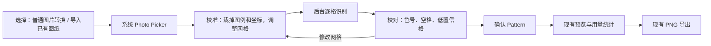
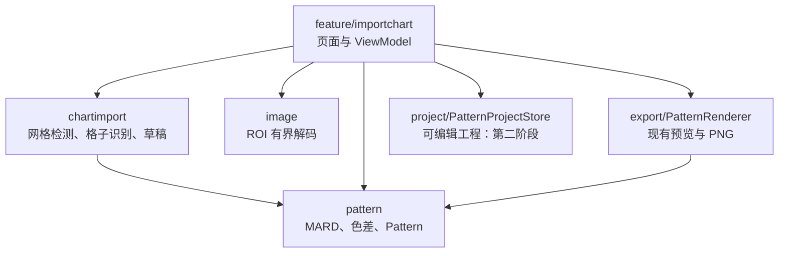

# 已有拼豆图纸导入与逐格复原架构

> 状态：设计稿 · 2026-09-26  
> 适用工程：`android-app` v0.4.0，Android 原生 Kotlin / Jetpack Compose  
> 专家路由：`$agency engineering-software-architect`

## 1. 目标、现状与成功标准

**目标**：用户导入一张已经绘有拼豆格子的截图或正视图，校准图纸区域和网格，把它复原为可校对的逐格颜色矩阵，最后使用现有的图纸预览与 PNG 导出。这里的“拼豆版图纸”指 APP 内的数字格子图，不涉及实体智能拼豆板或蓝牙控制。

**现状**：`ConvertScreen` 只提供普通图片转图纸；`PatternGenerator` 按目标网格重新采样像素并匹配 MARD 291 色；`Pattern` 保存只读 `IntArray`，格子必须是色库索引；`PatternRenderer` 共用矩阵绘制预览和 PNG；结果只留在当前会话，没有工程保存。直接把已有图纸送入普通图片转换会把网格线、坐标、格内文字和图例混入颜色，并可能改变原格数。

**可验证的完成标准**：

1. 导入清晰、正视、轴对齐的 8～128 行列图纸，用户可调整区域、行列、起点与格距；叠加线应贴合原图格边。
2. 识别结果按原图行优先顺序逐格表示；不确定格可定位、修改，待确认格不能静默导出。
3. 白豆与无豆空格能被明确区分；图例色号与自动匹配的结果可校对。
4. 确认后预览、颗数统计和导出 PNG 读取同一个 `Pattern` 快照，结果一致。
5. 可保存为 APP 内可编辑工程，退出 APP 后重新打开，仍能继续校对；PNG 供分享和打印。
6. 原“普通图片转图纸”路径通过回归检查；无需联网或全相册权限。

## 2. 用户流程



- 入口增加“导入已有拼豆图纸”。保留现有“图片转拼豆图纸”，两条流程在确认 `Pattern` 后汇合。`MainActivity` 现只加载 `ConvertScreen`，首版可用简单的首页流程选择，不必为两个页面引入导航框架。
- 选图后显示全图。用户先框选**仅格子主体**；图例、页眉、行列数字留在区域外。如果图例存在，另可框选图例区域，两个区域不能混淆。
- 自动给出行列、格线起点、格距建议，叠加网格供用户拖动边界与修正行列。未检测出网格时仍可手动输入并校准。
- 识别后显示原图与结果的对照视图，优先列出待确认格和低置信格。支持点格改色号、设为空格、对同一识别色批量替换、撤销/重做。图例色号先由用户核对，再批量映射到格子。
- 只有“待确认=0”才允许确认。确认时创建不可变 `Pattern`，再沿用现有预览、用量和 PNG。编辑过程可保存为 APP 内工程；修改校准参数会使旧识别结果失效，需重新识别。

## 3. 处理管线与算法边界

### 3.1 图像坐标与网格

所有校准参数都相对于 **EXIF 方向修正后的原图** 保存。`ChartRegion` 使用归一化的左、上、右、下边界；`GridGeometry` 表示列、行、格线起点与水平/垂直格距。MVP 只支持截图或正视、近似轴对齐的图纸；斜拍和透视变形需要另设四角校正阶段，不能把轴对齐算法称为通用拍照识别。

先用最长边不超过 1024 的预览做交互。识别时按选中 ROI 有界解码，工作图最长边不超过 2048，保留图片方向与 sRGB 一致性。现有 `ImagePipeline.decodeRegion` 绑定普通图片的 `CropSpec` 和目标网格宽高比，不应直接复用；应在 `image` 包抽出可接受独立 ROI 的解码函数。若原图压缩到格子只有寥寥像素，提示清晰度不足并允许手动校对。

自动建议可分别对横、纵方向的边缘强度求投影，从重复峰值估算周期与格线；输出候选的起点、格距、行列以及质量指标。自动建议只负责起点，不覆盖用户校准。叠加线与实际图纸格边的吻合由用户确认。每格坐标按 `x = x0 + column * pitchX`、`y = y0 + row * pitchY` 计算，始终在 ROI 内检验边界。

### 3.2 单格颜色与色号

图纸格内常有网格线、色号文字、水印和压缩噪声。每格先避开边缘，再从多个子窗取样，对候选颜色做稳健聚类或主色选择；不能只取中心点，也不能直接用整格平均。黑底白字与白底黑字都要保住占主要面积的背景色。

颜色映射采用现有 `ColorMath` / `Mard` 的 Lab(D65) 和 ΔE00。额外记录色彩纯度、第一与第二候选距离差、格子像素尺寸、网格质量，作为**校对排序分数**，不宣称它是经过标定的正确概率。图例里若有色号，应先建立“图例色块 → 已确认 MARD 色号”映射，再据色块为格子赋号；用户手动赋值优先级最高。没有图例时使用 MARD 近似匹配，并在界面说明这一结果是参考色近似。

图纸若采用非 MARD 色卡，不可仅凭相同的字母数字认作 MARD 同色。图像颜色也无法区分相同 RGB 的不同色号，例如当前色库的 Q4 / R11；此时必须依赖图例文字或人工确认。若以后加入 OCR，优先只在用户框选的图例中做**本地 OCR**，把识别出的 code 和色块位置交给用户核对；不要为了 MVP 对每一格都运行 OCR。首版保持纯离线几何与颜色识别，手动校对色号。

### 3.3 空格、白豆和待确认

识别草稿的单格取值约定：`>=0` 为 MARD 索引、`-1` 为空格、`-2` 为待确认。空白背景不等于 H2 白豆：自动分类无法可靠区分时标记待确认，让用户选择。导出前必须没有 `-2`。

若产品确认要支持真正的空格，需对现有 `Pattern` 做小范围兼容扩展，允许 `-1`，并同步修改统计、Canvas 绘制和 PNG：空格显示为透明或无豆棋盘背景，不印色号，不计入颗数；不变量为 `counts.sum() + emptyCount == rows * columns`。普通图片转换仍输出全填满矩阵。若本轮仅做“每格都有豆”的图纸，可暂缓 `Pattern` 扩展，但 UI 必须明确“白色一律视为 H2”，不能悄悄把空格当白豆。

## 4. 数据契约与状态

```kotlin
data class ChartRegion(val left: Float, val top: Float, val right: Float, val bottom: Float)
data class GridGeometry(val columns: Int, val rows: Int,
    val originX: Float, val originY: Float, val pitchX: Float, val pitchY: Float)
data class CellEvidence(val value: Int, val score: Float, val reason: String?)
data class RecognitionDraft(val region: ChartRegion, val geometry: GridGeometry,
    val paletteRevision: String, val cells: IntArray,
    val evidence: List<CellEvidence>)
```

`RecognitionDraft` 是可校对的工作结果，不能直接交给 `PatternRenderer`。ViewModel 更新单格时创建新快照或局部复制，撤销栈只保存编辑操作或差量；确认时验证尺寸、索引、空格策略、无待确认格，再创建 `Pattern` 的防御性副本。`Pattern` 仍是预览、颗数统计和导出的唯一真源。`sourceUri` 不应作为可长期恢复的工程数据；Photo Picker 授权与文件生命周期不保证日后仍可读取。

完整功能需要“保存后重新打开并继续校对”，因此增加应用私有目录中的版本化工程文件：`schemaVersion`、网格几何、ROI、MARD 色库版本、格子矩阵、空格标记、用户编辑状态、原图私有副本路径/哈希。导入时复制原图到私有目录，不依赖临时 Photo Picker URI。保存先写临时文件、校验后原子替换；读取时验证 schema、尺寸和色库版本。这个阶段不需要 Room，项目列表和复杂检索出现后再评估数据库。PNG 仅是交付图，不等同可编辑工程文件。

## 5. 代码落点与依赖方向



- `MainActivity.kt`：增加两个流程的入口与最小页面切换。
- `feature/importchart/ImportChartScreen.kt`：ROI/网格叠加、图例选择、对照校对与确认。保持与现有页面独立。
- `feature/importchart/ImportChartViewModel.kt`：步骤状态、后台任务、进度与取消、操作撤销、确认快照。识别失败不覆盖上一份可用草稿。
- `chartimport/GridDetector.kt`、`GridGeometry.kt`、`CellRecognizer.kt`、`RecognitionDraft.kt`：纯 Kotlin 核心；不引用 Android 或 Compose，方便用合成图纸测试。
- `image/ImagePipeline.kt`：新增按已有图纸 ROI 解码的能力，与照片生成共用 EXIF/sRGB 处理，不改普通转换采样策略。
- `pattern/Pattern.kt`、`export/PatternRenderer.kt`：仅在决定支持空格时扩展。确认后复用这两个模块。
- `project/PatternProjectStore.kt`：私有目录版本化读写，保证退出 APP 后恢复校准和编辑状态。

依赖方向保持 `Compose/ViewModel → chartimport + image → pattern`，渲染读取 `Pattern`；识别核心不依赖页面、图片 URI 或 Android Bitmap。保留单个 `:app` Gradle 模块，按包区分职责。

## 6. 实施顺序与验收

**阶段 1：可校准的复原闭环。** 加入口、选图、ROI、手动网格、逐格稳健取色、低置信标记、单格修改、确认和现有 PNG 导出。自动网格只提供建议。合成图纸覆盖 8×8、29×29、64×64、128×128，含坐标、图例、格内文字、黑白豆与空格；人工校正后逐格结果必须与标注矩阵一致。

**阶段 2：效率与恢复。** 完成自动网格候选、图例色块批量映射、批量替换、撤销/重做、版本化工程保存与打开。核验关闭进程后恢复矩阵、色库版本、校准参数和已确认修改；旧照片转换不变。这是完整功能交付的一部分。

**阶段 3：复杂输入。** 基于实测误差再选本地 OCR、四角透视校正及非 MARD 色卡支持。对每项功能维护带人工标注的图纸样本集，分别报告自动建议质量与人工校正后的最终正确率；不先承诺未经测量的自动识别准确率。

各阶段共通门槛：预览、PNG、用量读取同一快照；取消与失败不输出半成品；无需联网；Android 12 和目标发布系统的手势、内存、图片解码、文件保存需真机验收；128×128 能显示进度并取消。性能阈值以设备测量后确定。

## 7. 关键架构决策

**ADR-01：独立反解析管线。** 备选方案是复用 `PatternGenerator`。它能减少新代码，但会重采样原网格并把线条/文字视作颜色，无法保证复原。决定新增 `chartimport`，只共享 MARD 色差、`Pattern` 和渲染器；代价是多一条识别路径，但不扰动已完成的照片路径。

**ADR-02：离线规则识别先行。** 备选方案是本地 OCR 或云端 OCR。决定先做几何、颜色和人工色号校对；本地 OCR 留给图例识别阶段，云端 OCR 暂不纳入。原因是当前 APP 无网络、图例格式多变，OCR 也不能替代网格校准或判断白豆与空格；代价是首版用户需要校对更多色号。

**ADR-03：确认矩阵与可编辑工程分离。** PNG 和 `Pattern` 负责稳定输出；`RecognitionDraft` 负责未确认与编辑证据。可恢复工程采用版本化本地文件。代价是两种状态之间需要明确“确认”边界，但能防止低置信或半成品直接导出，并满足跨重启续改。

## 8. 需要产品确定的两点

1. 目标图纸中“没有放豆子的格子”是否必须保留为空格？本设计建议支持，技术影响是 `Pattern` 与渲染器的小幅兼容扩展。
2. 若希望第一批内测包就能跨重启继续校对，应把阶段 2 的工程保存提前并与阶段 1 一起交付；本设计的完整功能包含这一能力。
